# Cube World

**Author:** Thu Le  
**Course:** Computer Graphics I  
**Repository:** [github.com/lethu07/cube-world](https://github.com/lethu07/cube-world)  
**Live Demo:**  [lethu07.github.io/cube-world](https://lethu07.github.io/cube-world/)  
**Demo Video:**  [youtu.be/0i1YV2khvaI](https://youtu.be/0i1YV2khvaI) 

## Design plan

The goal is to create a scene made from a grid of cubes using HTML, CSS,
JavaScript, and WebGL.

My idea is to make a hurricane landscape that can be viewed from a slowly orbiting camera. The terrain uses images to sample color-map data and height-map data to form a raised storm shape. In the sky, small yellow stars made from cubes travel along a Bezier curved path.

**Sample image:** 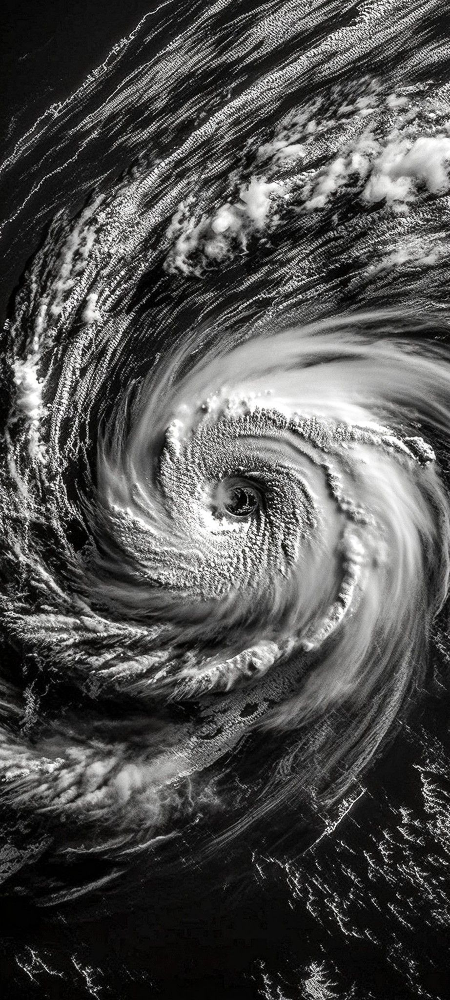

**Design sketch:** 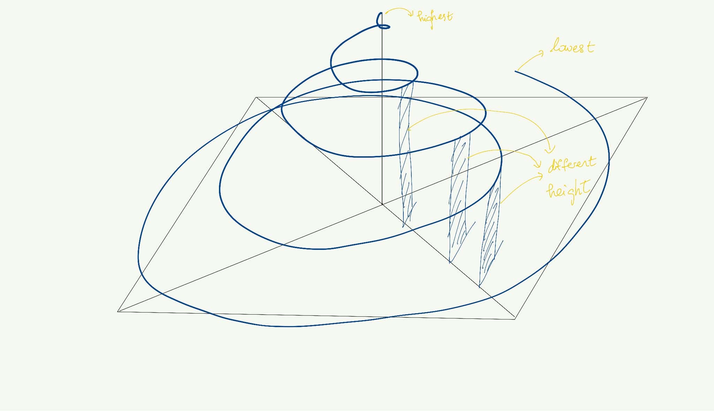

**Reference board:**
|  | 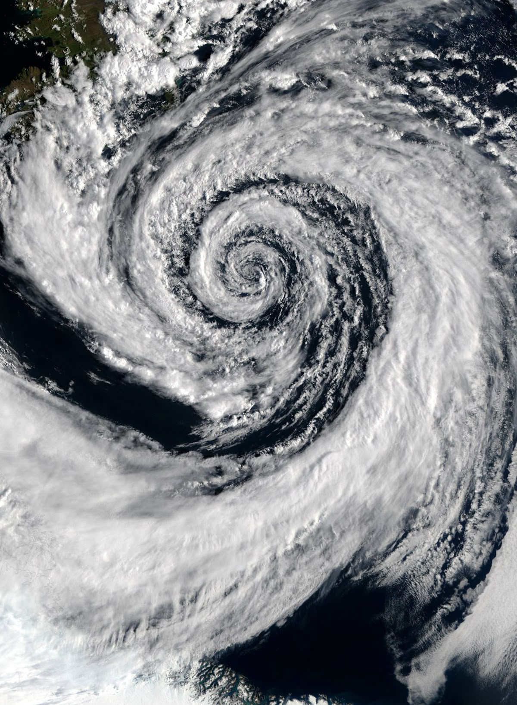 | 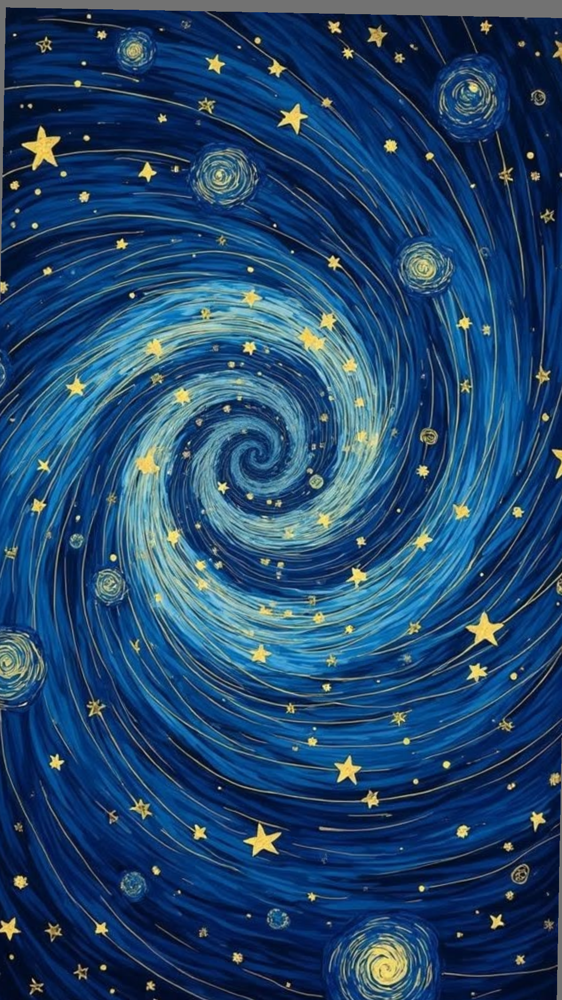 |
|---------|---------|---------|
| 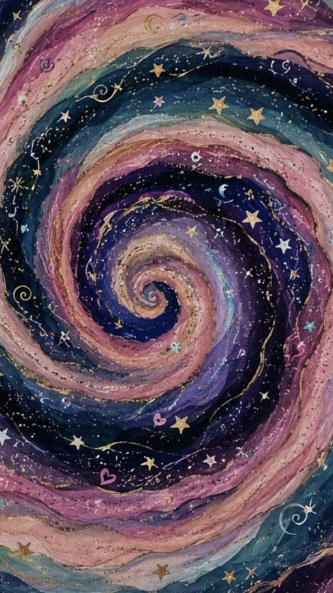 | 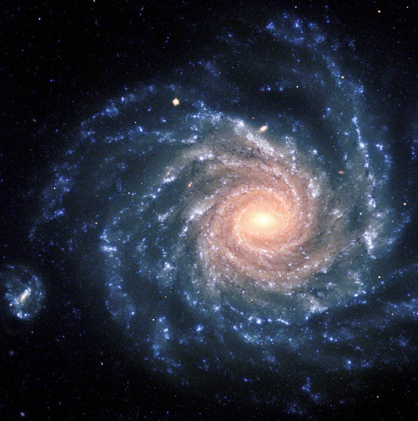 |

## Features and controls

- **Scene level:**
  - **Level 1a:** a flat grid of cubes
    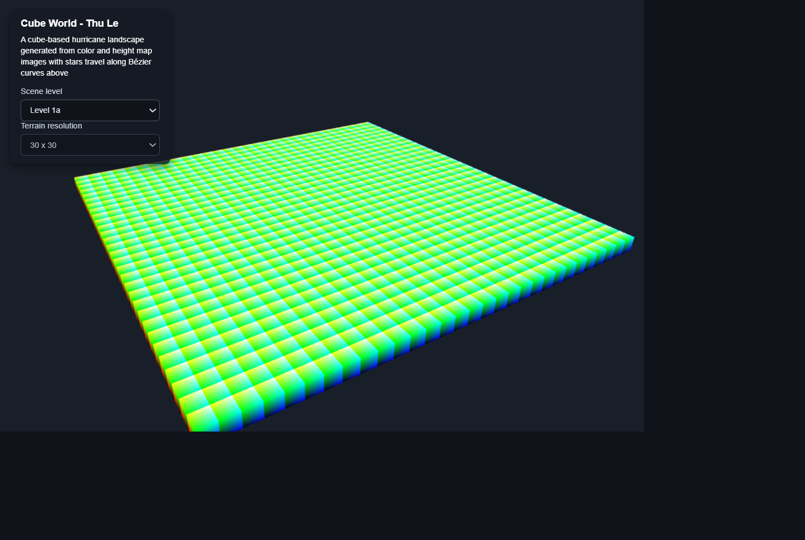
  - **Level 1b/c:** a grid of cubes with varied heights and colors.
    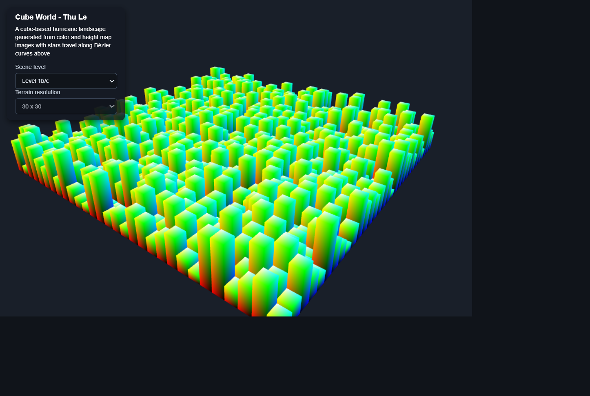
  - **Level 2:** terrain generated from sampled color and height maps.
    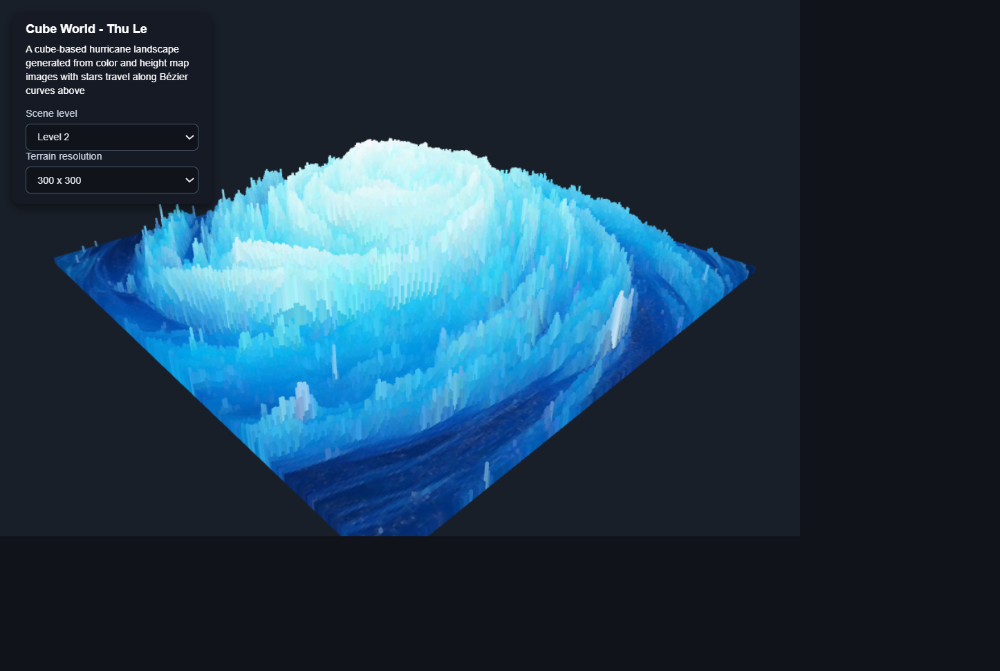
    - Level 3: add skyscape (the stars)
    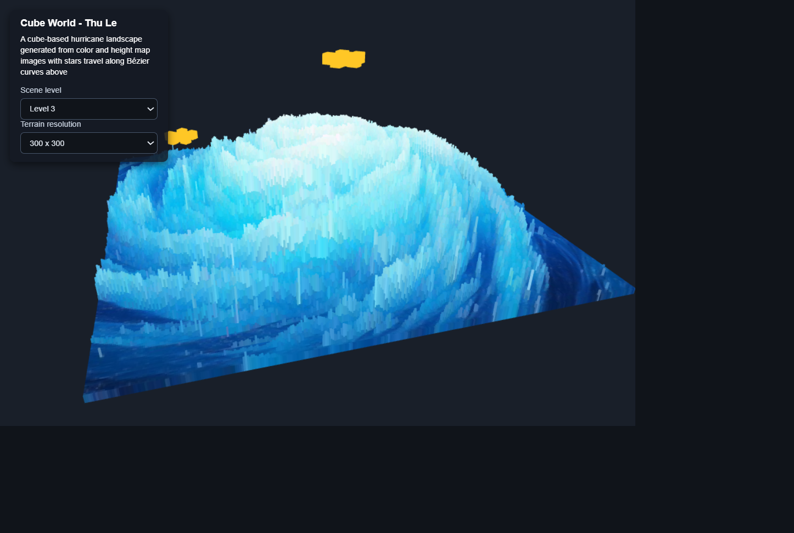
  - **Level 4:** add distance-based fog, blending distant objects toward the background
    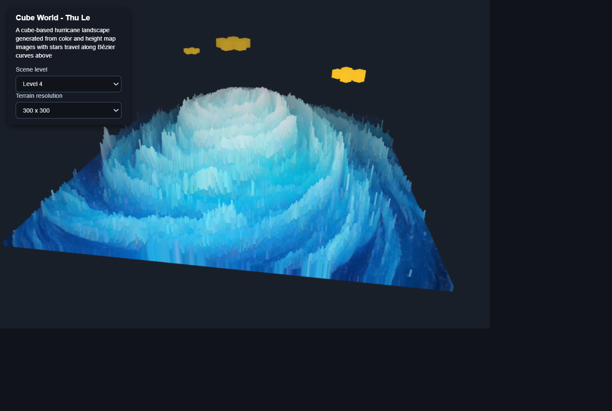
- **Terrain resolution:** For Levels 2–4, choose 30 x 30, 100 x 100, or 300 x 300. Higher resolutions show more detail and may run more slowly.
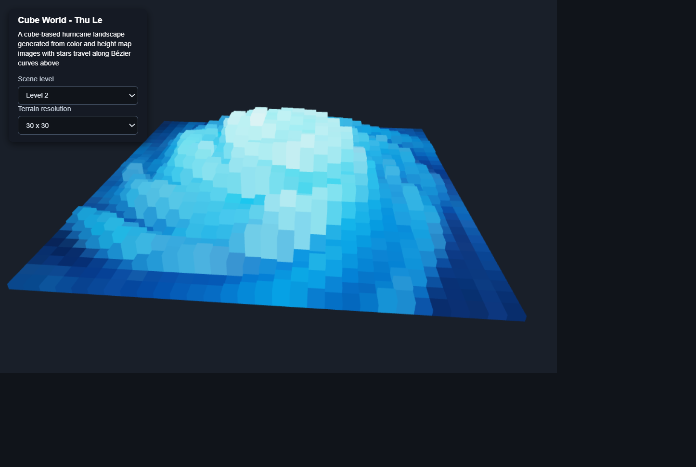
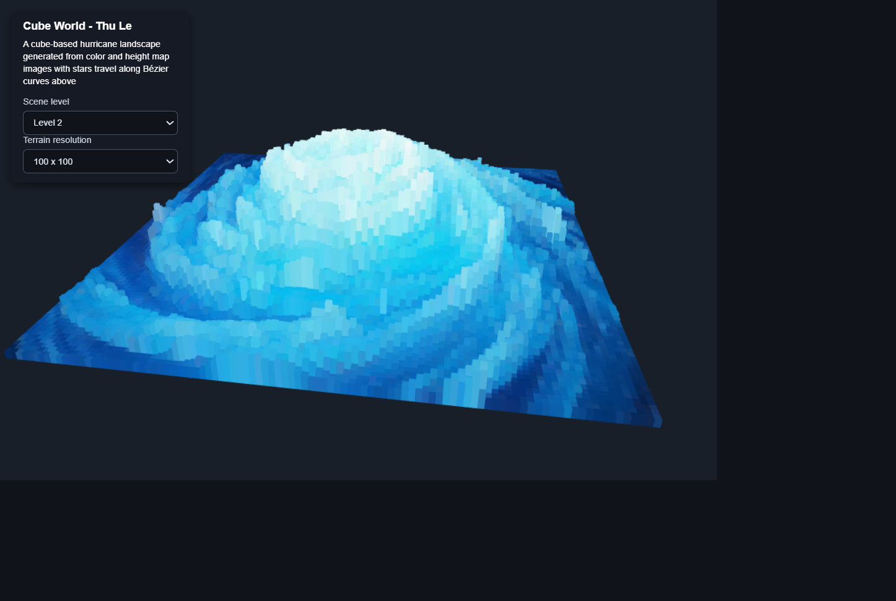

- **Camera:** The camera automatically orbits the center of the scene

## Implementation

### Cube geometry and triangle drawing

The cube is described by vertex positions. Each of its six faces is made from
two triangles, for 36 vertices total. The renderer draws these with
`gl.TRIANGLES`. It does not draw a separate wireframe or line representation.
The visible surface colors are rasterized and interpolated across triangle
fragments.

### 3D transformations

Each cube reuses the same geometry. A model matrix translates it into the grid
and scales it to the required width, depth, and height. The star pieces also
use a fixed Y-axis rotation. These model transformations are separate from the
camera's view transformation.

### Camera and pinhole projection

The `lookAt` view matrix aims the camera at the center of the terrain. Its
position changes around that center over time. The perspective projection
matrix uses a field of view, canvas aspect ratio, and near/far clipping planes
to create the pinhole-camera perspective: farther objects appear smaller.

### Image sampling and terrain generation

The color and height PNGs are drawn to a small canvas at the selected
resolution. `getImageData` returns the sampled RGBA values. Each sample
produces one cube: its RGB values set the color, while weighted grayscale
brightness from the height map determines its height. Height values below the ocean
threshold stay low, while a center-to-edge boost for the values above threshold emphasizes the storm shape. The terrain grid size remains the same as resolution changes, and the cubes' sizes changes to fit in.

### Vertex colors and shaders

For level 1, each cube vertex receives a color derived from its local position.
The vertex shader passes that color to the fragment shader, which interpolates
it across the triangles. For levels 2–4, each cube uses its sampled map color.

### Bézier path and animation

The stars' path is a cubic Bézier curve evaluated with repeated linear
interpolation (De Casteljau's algorithm). Time controls the curve parameter so
each star moves forward and then back along the path. Phase offsets keep them
from moving together.

### Depth and Level 4 fog

Depth testing lets nearer cube faces cover farther ones. For Level 4, the
vertex shader passes camera-space distance to the fragment shader. A
`smoothstep` value blends more distant fragments toward the background color.
This is atmospheric haze, not a uniform brightness change or a lighting model.

## Future work

Here are a few ideas I think but didn't have enough time or knowledge to do yet:

- Experiment with a skybox or lighting
- Improve performance at 300 x 300
- Add more complex objects to the skyscape
- Refine the height-generation algorithm to shape the raised storm

## AI use and reflection

I mainly used AI to better understand graphics concepts, debug issues, and simplify code when it became unnecessarily complicated. I also used it to brainstorm the fog effect and learned to use the shader's `smoothstep` function. I reviewed and tested after every use to make sure the code is correct.
